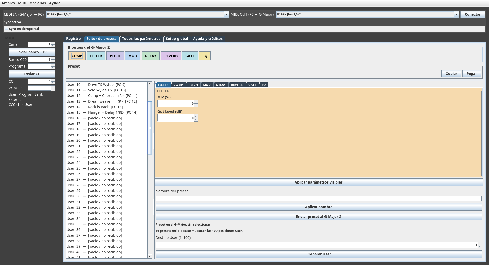
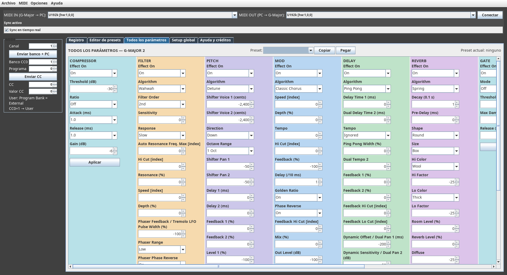
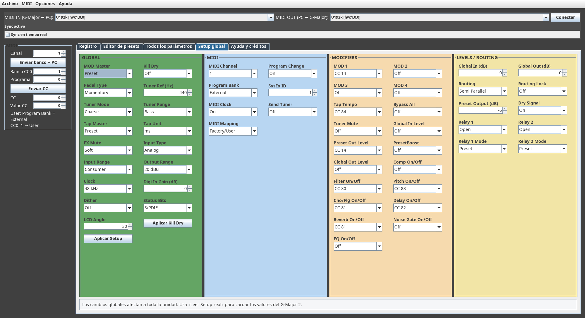
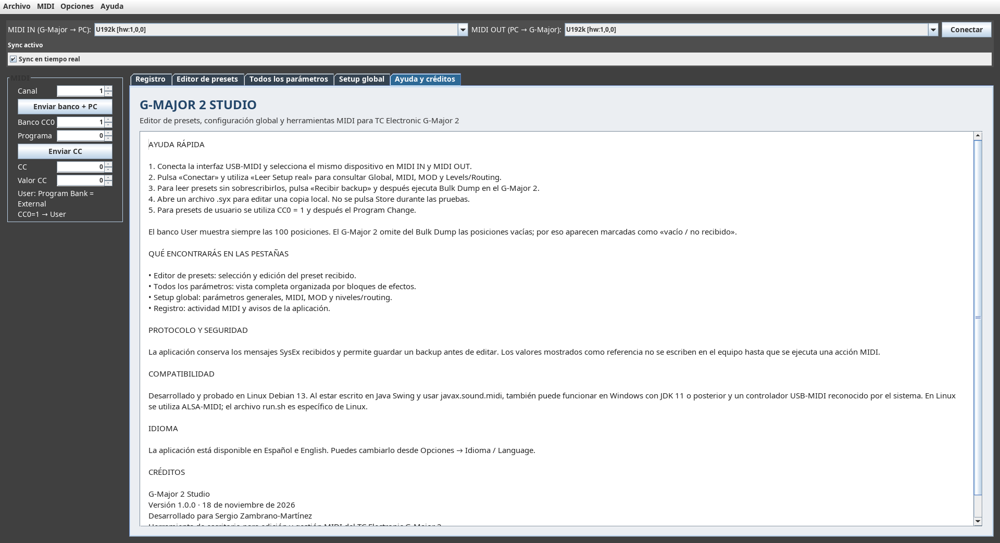

# G-Major 2 Studio

**Beta pública 1.0.0-beta** — 19 de noviembre de 2026.

> Editor MIDI/SysEx y biblioteca para TC Electronic G-Major 2. Probado en
> Debian 13 con Java 11 y una interfaz Behringer UMC404HD.

[Español](#español) · [English](#english)

## English

G-Major 2 Studio is a Java Swing MIDI/SysEx editor and librarian for the TC
Electronic G-Major 2. It runs on Linux and Windows with Java 11 or later.

It can receive and save bulk dumps, restore `.syx` files, manage the 100 User
slots, prepare a preset for a selected User slot without pressing `STORE`, and
edit documented preset and global parameters.

This is a public beta. Some algorithm-specific parameters and modifier/global
SysEx mappings still require validation against real hardware. Always keep a
backup before sending data to the unit.

See [installation](docs/INSTALACION.md), [MIDI safety](docs/SEGURIDAD-MIDI.md)
and [contributing](CONTRIBUTING.md).

## Screenshots / Capturas

### Preset editor



### All parameters



### Global setup



### Help and credits



## Español

Aplicación de escritorio ligera para Linux para trabajar con un TC Electronic
G-Major 2 mediante una interfaz MIDI (DIN de 5 pines + interfaz USB-MIDI).

## Estado actual

- Detecta y abre puertos MIDI de entrada y salida mediante ALSA/JAVA MIDI.
- Guarda volcados SysEx recibidos en archivos `.syx`.
- Restaura archivos `.syx` enviándolos al G-Major 2.
- Envía cambios de banco, programa y mensajes CC.
- Muestra en el registro los mensajes recibidos y enviados.

El G-Major 2 debe ponerse en su menú MIDI y ejecutar el **Bulk Dump** para
realizar una copia. La aplicación escucha durante 60 segundos después de
pulsar «Recibir backup». Para restaurar, el G-Major 2 siempre está preparado
para recibir un bulk dump SysEx.

## Requisitos

- Linux con ALSA, o Windows con un controlador MIDI compatible.
- JDK 11 o posterior.
- Interfaz USB-MIDI con sus conectores MIDI IN y MIDI OUT conectados al
  G-Major 2. El equipo no tiene USB propio.

## Publicación y licencia

El proyecto ha sido desarrollado y probado en **Linux Debian 13**. Para el
código fuente se recomienda la licencia **MIT**, que permite compartirlo,
modificarlo y reutilizarlo con pocas restricciones. Creative Commons resulta
más apropiada para la documentación, capturas y material gráfico que para el
código. Antes de publicar una versión definitiva conviene añadir el texto
completo de la licencia MIT y conservar estos créditos:

**G-Major 2 Studio — Sergio Zambrano-Martínez.**

El código se publica bajo licencia MIT. Consulta `LICENSE`. La documentación
y las capturas pueden reutilizarse por separado respetando sus créditos.

## Ejecutar

```bash
./run.sh
```

Para aislar problemas de la interfaz gráfica, también se puede capturar un
dump directamente con ALSA. El puerto depende del equipo y debe consultarse
con `amidi -l`:

El código Java y la interfaz Swing son multiplataforma. En Windows hay que
compilar y ejecutar las clases con `javac` y `java`, o crear un acceso directo;
`run.sh` es el lanzador utilizado en Linux.

```bash
./capturar-sysex.sh hw:2,0,0 gmajor2-prueba.syx
```

También se puede compilar directamente:

```bash
mkdir -p build
javac -encoding UTF-8 -d build $(find src -name '*.java' -print)
java -cp build com.gmajor2.midi.GMajor2Controller
```

## Aplicación Linux autocontenida

El paquete de lanzamiento `G-Major-2-Studio/` incluye un runtime Java y se
ejecuta desde `bin/G-Major-2-Studio`. Se genera con `jpackage` en Linux.

## AppImage

El script `make-appimage.sh` crea una estructura AppDir y necesita que
`appimagetool` esté instalado o disponible en el `PATH`.

## Próximo paso para editar todos los parámetros

El protocolo de edición SysEx del G-Major 2 no aparece en el manual de usuario
como una tabla pública completa. La aplicación ya conserva los volcados sin
modificarlos; para añadir un editor completo hay que capturar un dump de prueba
antes y después de cambiar cada parámetro, o disponer de la especificación del
firmware. Así se pueden descubrir las direcciones y la comprobación de suma sin
arriesgar presets.

## Investigación de editores existentes

Se localizaron dos proyectos relevantes:

- [Vyzor G-Major/2](https://www.manualshelf.com/manual/tc-electronic/g-major-2/vyzor-english.html): editor oficial de TC Electronic/PSICraft para Windows y macOS. Su guía confirma que edita presets, bancos de usuario, ajustes globales y modificadores.
- [FreeMajor](https://github.com/linuxmao-org/FreeMajor): editor nativo para Linux, Windows y macOS, con ALSA-MIDI, JACK-MIDI y CoreMIDI. Está publicado bajo Boost Software License 1.0, pero se refiere al G-Major original, no explícitamente al G-Major 2; habrá que validar su formato antes de reutilizarlo.

También existe [GMajor2Editor](https://github.com/mosinve/GMajor2Editor), una adaptación Java del antiguo GLydian para G-Major 2. El repositorio contiene principalmente un lanzador y clases compiladas/dependencias ausentes, por lo que no sirve directamente como base mantenible.

### Resultado de las pruebas con hardware real

El primer backup de prueba tenía 9239 bytes y contenía 15 presets. En una
captura posterior se recibieron 16 mensajes de preset de 615 bytes:

- 1 mensaje inicial de 14 bytes.
- 15 mensajes de preset de 615 bytes en la primera captura.
- Cada preset contiene 612 bytes de datos, checksum y `F7`.
- Los checksums de los mensajes recibidos han sido verificados correctamente.
- Los presets ocupan las posiciones User 1–13, 98 y 100; las demás posiciones no
  se enviaron porque están vacías. La aplicación muestra igualmente las 100
  posiciones User y marca las vacías como «vacío / no recibido».

La estructura coincide con la usada por FreeMajor: la posición del preset se
codifica en los bytes 6 y 7, el nombre ocupa los bytes 8–27 y el checksum es la
suma módulo 128 de los datos desde el byte 28. Ya podemos comenzar el editor
de presets G-Major 2 sin tener que adivinar el formato SysEx.

### Comparativa G-Major 1 / G-Major 2

FreeMajor es una referencia del G-Major 1, no una tabla definitiva para este
proyecto. La tabla actual usa los algoritmos documentados del G-Major 2:
Filter incluye Wahwah, Touch Wah, Auto Wah, Resonance Filter, Touch Resonance
Filter, Tremolo y Panner; Pitch incluye Detune, Whammy, Octaver, Pitch Shifter
e Intelligent Pitch Shifter; Modulation incluye Classic/Advanced Chorus,
Tri-Chorus, Classic/Advanced Flanger, Through Zero Flanger, Vibrato, phaser y
Univibe; Delay incluye Ping Pong, Dynamic, Dual y Reverse.

Por eso el editor mantiene una tabla específica del G-Major 2 y no recorta los
índices de algoritmo a los límites del G-Major original. Los offsets de
inicio de los bloques ya observados son Filter 228, Pitch 292, Modulation 356,
Delay 420, Reverb 484, Noise Gate 548 y EQ 568 dentro de los 612 bytes de
datos. Los parámetros comunes pueden aprovechar la codificación de FreeMajor,
pero los tipos y parámetros exclusivos del G-Major 2 se añadirán a su propia
tabla antes de permitir su escritura.

La versión actual permite abrir y guardar backups, mostrar las 100 posiciones
User, editar nombres y aplicar parámetros del modelo de preset, recalculando
el checksum antes de guardarlo. Los parámetros que dependen de un algoritmo
concreto se mantienen agrupados por offsets compartidos y deben validarse
contra el hardware antes de presentarse como una escala física exacta.

La vista visual incluye tarjetas coloreadas y pestañas para Filter, Compressor,
Pitch, Modulation, Delay, Reverb, Gate y EQ. En esta primera fase permite leer
y aplicar los parámetros comunes de mezcla/nivel de los bloques, además de
Threshold, Max Damping, Release y Gain de Gate, Compressor y EQ, usando la
estructura común del formato SysEx.

También se añadieron Delay Time y Feedback para Delay, y Decay y Pre-delay
para Reverb. Los tipos se leen con los índices específicos observados en los
backups del G-Major 2 y contrastados con el manual.

La interfaz usa ahora la paleta de familias propuesta: naranja para Filter,
cian para Compressor/Gate, amarillo para EQ, azul para Modulation, morado para
Reverb, blanco para Pitch, verde para Delay y verde claro para Pitch Delay.
También incluye las vistas separadas Global, MIDI, MOD y Levels/Routing, con
Input/Output, routing y relés agrupados fuera de los presets.

El archivo `GMajor2ParameterModel.java` contiene ahora una tabla centralizada
de parámetros de preset: offsets, rangos, unidades y opciones. La pestaña
«Todos los parámetros» permite leer y aplicar esa tabla por bloque, evitando
que la interfaz tenga que conocer directamente la codificación SysEx.

La tabla se amplió con los estados On/Off de cada bloque, los parámetros
específicos de Filter, Pitch, Modulation y Delay, y los campos completos de
Reverb y EQ. Los modificadores bit-packed y la configuración global siguen
tratándose como estructuras separadas, porque no son enteros SysEx de cuatro
bytes como los parámetros de audio.

La pestaña «Todos los parámetros» funciona como una vista ALL tipo Vyzor: los
bloques aparecen en columnas simultáneas dentro de un panel horizontalmente
desplazable. Cada columna tiene su propio botón de aplicación. Incluye además
PRESET para Tap Tempo y evita sobrescribir otros bloques al aplicar una sola
columna.

Los valores se cargan desde el mensaje SysEx del preset al seleccionarlo. El
tipo de Delay se muestra ahora como selector con `Ping Pong`, `Dynamic`, `Dual`
y `Reverse`, y Tempo se muestra con sus divisiones musicales en lugar de un
índice numérico.

Los selectores de Algorithm de Filter, Pitch, MOD y Reverb también están
visibles en la vista ALL. Incluyen los algoritmos documentados del G-Major 2 y
conservan etiquetas de índice únicamente en los rangos discretos cuyo valor
interno depende de la tabla del firmware. Los valores se cargan al seleccionar
el preset y la vista sigue el orden SysEx del G-Major 2: Compressor, Filter,
Pitch, Modulation, Delay, Reverb, Gate y EQ.

La vista de presets también permite seleccionar un preset desde la aplicación:
al seleccionarlo se envía su cambio de programa por MIDI. El botón «Enviar
preset al G-Major 2» y los cambios de nombre o Threshold envían además el
SysEx del preset individual, sin restaurar todo el banco. Esto permite una
edición temporal en tiempo real; para conservarla en un archivo hay que usar
«Guardar datos recibidos».

El botón «Sincronizar desde G-Major» y la casilla «Sync en tiempo real» separan
la biblioteca local del equipo conectado. La sincronización prepara la
recepción del banco y carga los presets recibidos en la lista; después hay que
ejecutar `MIDI → Bulk Dump → ENTER` en el G-Major 2. No se crea ni sobrescribe
ningún archivo automáticamente. Con Sync activo, seleccionar presets y aplicar
parámetros envía los cambios al equipo; con Sync desactivado, se editan solo
los datos cargados localmente.

La selección de presets de usuario usa MIDI Bank Select MSB (CC 0) = 1 antes
del Program Change. El banco 0 corresponde a los presets de fábrica, que era
la causa de que `Testolino` seleccionara el primer preset de fábrica.

En el G-Major 2 hay que configurar una vez `MIDI → Program Bank → External`.
Con `External`, `CC 0 = 0` selecciona Factory y `CC 0 = 1` selecciona User.
Si está seleccionado `Factory` o `Custom`, el equipo puede ignorar el banco
recibido o aplicar el MIDI Mapping en lugar de seleccionar directamente el
preset de usuario.
